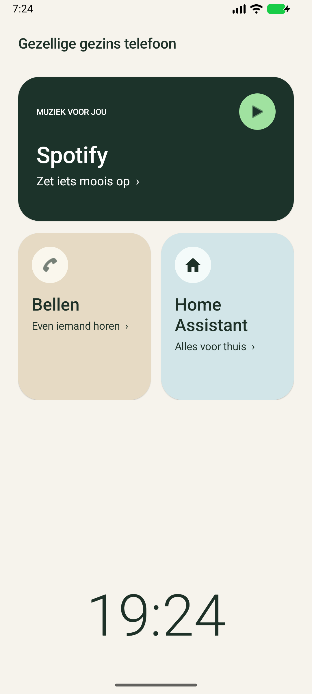
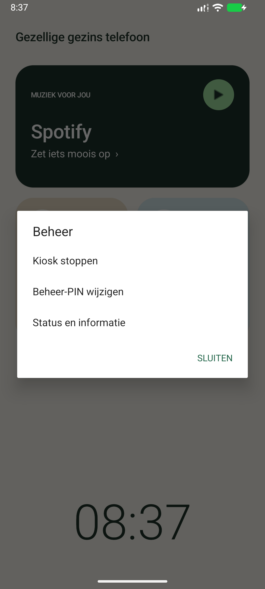

# Gezellige gezins telefoon

Een rustig Android-startscherm voor een gedeelde gezinstelefoon, met directe toegang tot **Spotify**, **Bellen** en **Home Assistant**. De app kan als gewone launcher worden gebruikt of als beheerde kiosk waarin alleen de toegestane apps bereikbaar zijn.

## Zo ziet het eruit

<p>
  <a href="docs/images/startscherm.png"></a>
  <a href="docs/images/beheer.png"></a>
</p>

*Startscherm en beheermenu in een emulator, zonder persoonlijke gegevens. Klik op een afbeelding om deze groter te bekijken. De beschikbare beheeracties verschillen per buildvariant en kioskstatus.*

## Functies

- **Spotify:** een grote kaart om de muziekapp te openen.
- **Bellen:** toegang tot Samsung Telefoon voor contacten, uitgaande en inkomende oproepen.
- **Home Assistant:** een eigen kaart naast Bellen om de Companion-app te openen. Zowel de gewone als de minimal-versie wordt herkend.
- **Grote klok:** altijd een 24-uursweergave (`HH:mm`) onderaan het scherm.
- **Alles op één scherm:** Spotify bovenaan, Bellen links en Home Assistant rechts op de tweede rij.
- **Verborgen beheer:** geen zichtbare beheerknop. Tien keer tikken op de klok opent de PIN-verificatie, zonder melding, afteller, geluid of trilling.

De launcher opent de bestaande apps. Hij speelt zelf geen muziek af, voert zelf geen telefoongesprekken en bedient niet rechtstreeks Home Assistant-apparaten.

## Beheer openen

1. Tik **tien keer op de tijd**.
2. Voer de **aparte beheer-PIN** in.
3. Kies de gewenste actie, zoals **Kiosk starten**, **Kiosk stoppen**, **Beheer-PIN wijzigen** of **Status en informatie**.

De tikkenteller wordt gereset zodra je de launcher verlaat of een andere app opent. De verborgen ingang vervangt de PIN-beveiliging niet.

Bij de eerste instelling bevestig je, als die aanwezig is, eenmalig de bestaande Android-schermvergrendeling. Daarna kies je een eigen beheer-PIN van **6 tot 12 cijfers**. Gebruik hiervoor een andere code dan de normale toestelontgrendeling.

Een beheersessie verloopt na **30 seconden** en sluit wanneer je de app verlaat. Na vijf onjuiste PIN-pogingen geldt een opgeslagen wachttijd van 30 seconden. Er is geen standaard-PIN of algemene ontgrendelcode.

## Kioskmodus

De beheerde kiosk gebruikt Android **Device Owner** en **Lock Task**. De actieve kiosk beperkt appwisselen en maakt de launcher het vaste startscherm.

Tijdens kioskmodus:

- zijn Spotify, Samsung Telefoon en de benodigde systeemonderdelen voor bellen toegestaan;
- wordt de geïnstalleerde Home Assistant-variant aan de toegestane apps toegevoegd;
- blijft het scherm aan, ook wanneer een andere toegestane app op de voorgrond staat;
- wordt het Android-vergrendelscherm onderdrukt; het bestaande patroon of de bestaande toestelcode blijft buiten kioskmodus behouden;
- blijven Home, meldingen, systeeminformatie en het aan-uitmenu beschikbaar;
- is het overzicht van recente apps niet beschikbaar.

**Kiosk stoppen** beëindigt Lock Task, stopt het scherm-aanbeheer en herstelt het opgeslagen kioskbeleid. De Device Owner-registratie blijft daarbij bestaan. Bij een herstelfout blijft de opgeslagen beleidskopie bewaard voor een volgende herstelpoging.

Installeren, openen of opnieuw opstarten van het toestel activeert de kiosk **niet automatisch**. Na een herstart kan eerst de normale Android-ontgrendeling nodig zijn.

## Wat moet vooraf geregeld zijn?

Voor gewone appstart moeten de betreffende apps geïnstalleerd en ingeschakeld zijn. Voor kioskactivering controleert de app bovendien:

- of hij Device Owner is;
- of er een beheer-PIN is ingesteld en het toestel ontgrendeld is;
- of Spotify, Samsung Telefoon en de benodigde belonderdelen beschikbaar zijn;
- of Samsung Telefoon de standaard bel-app is;
- of er geen onafgehandelde beleidskopie van een eerdere kioskproef bestaat;
- of de beheerder de begeleide start en hersteltoegang expliciet bevestigt.

Home Assistant is optioneel: ontbreekt de app, dan toont de kaart uitleg en blijven de andere functies bruikbaar. Installeer en configureer Home Assistant buiten kioskmodus. Serveradressen en inloggegevens worden niet door deze launcher opgeslagen.

Device Owner inrichten is een afzonderlijke beheerstap en kan, afhankelijk van de toestelstatus, een fabrieksreset vereisen. Regel eerst back-ups en een bruikbare herstelroute; de app voert zelf geen reset uit.

## Grenzen en aandachtspunten

- **Netwerk:** wifi en mobiele data worden via Android-instellingen beheerd. De app dwingt geen uitsluitend-wifi-verbinding af en blokkeert Spotify niet bij wifi-uitval.
- **Scherm:** de fysieke aan-uitknop, nabijheidssensor tijdens een gesprek, een lege batterij of systeembeperkingen kunnen het scherm alsnog uitschakelen. Gebruik voor langdurig gebruik bij voorkeur een lader en gematigde helderheid.
- **Toegestane apps:** een heel app-pakket wordt toegestaan, inclusief zijn eigen schermen en instellingen. Dit is geen garantie dat elke ongewenste route binnen zo'n app is afgesloten.
- **Bellen:** Android Telecom is naast Samsung Telefoon toegestaan voor het starten van oproepen. Berichten en videochat zijn niet afzonderlijk toegestaan. Controleer inkomende en uitgaande oproepen op de gebruikte firmware, ook na updates.
- **Beveiliging:** de PIN wordt niet leesbaar opgeslagen. De controle gebruikt een unieke salt, PBKDF2 en een apparaatgebonden Android Keystore-sleutel. De PIN-opslag en beleidsvoorkeuren zijn uitgesloten van back-up en overdracht.

## Ontwikkelen en bouwen

Het project gebruikt **Kotlin**, native Android Views en de meegeleverde Gradle-wrapper. Het pakket is `nl.woonkamer.kiosk`. De minimale Android-versie is 9 (API 28), de doelversie Android 16 (API 36) en de compile-SDK API 37. De belintegratie is gericht op Samsung Telefoon.

Open de projectmap in Android Studio en zorg dat de vereiste Android SDK en JDK beschikbaar zijn. De wrapper en toolchainconfiguratie leggen de benodigde buildversies vast. Houd `local.properties` met het lokale SDK-pad buiten Git.

| Buildvariant | Kioskactivering | Gebruik |
| --- | --- | --- |
| `debug` | Uitgeschakeld | Ontwikkeling en gewone app-tests |
| `release` | Uitgeschakeld | Standaardbuild zonder activering |
| `kioskTrial` | Ingeschakeld na beheerderverificatie en bevestiging | Begeleide proef; expliciet als `testOnly` gemarkeerd |

Bouwen en controleren, vanuit de projectmap:

```powershell
.\gradlew.bat assembleDebug assembleKioskTrial testDebugUnitTest lintDebug lintKioskTrial
```

Extra unit-tests voor de proef- en releasevariant:

```powershell
.\gradlew.bat testKioskTrialUnitTest testReleaseUnitTest "-Pandroid.onlyEnableUnitTestForTheTestedBuildType=false"
```

De APK's komen onder `app/build/outputs/apk/` terecht. Een `kioskTrial`-APK vereist bij installatie via ADB de optie `-t`.

De test-only-markering maakt een ontwikkelherstelroute met `dpm remove-active-admin` mogelijk voor een als test-only geregistreerde beheerder. Vervang zo'n eigenaar niet zomaar door een niet-test-only build: dat kan de herstelmogelijkheden veranderen. Deze proefvariant is geen afgeronde productie-uitrol.

### Tests

De repository bevat unit-tests voor de activeringsvoorwaarden, de geldigheid van beheersessies en de PIN-verificatie. Emulatorfixtures controleren onder meer de zichtbaarheid van de kaarten, de 24-uursklok, toegang na precies tien tikken en de PIN-wachttijd.

Een aparte Lock Task-fixture test scherm-aanbeheer bij appwisselen, de beheerdersexit en het herstellen van beleid. Deze vereist een vooraf ingerichte tijdelijke emulator. De fixtures weigeren uitvoering op fysieke toestellen en worden niet in de app-APK opgenomen.

Voor emulatorinstrumentatie bouw je `assembleDebugAndroidTest`. De alternatieve fixture selecteer je met de Gradle-eigenschap `kioskTestRunner=nl.woonkamer.kiosk.LockTaskInstrumentation`. Provisioning en toestemming voor emulatorbeleid vallen buiten de testcode.

## Privacy van de repository

Lokale paden, toestel-ID's, serveradressen, sleutels, eigen PIN-codes, privétestnotities, APK's en buildrapporten horen niet in Git. De afbeeldingen in deze README zijn gecontroleerde emulatorbeelden van de app; het zijn geen screenshots van persoonlijke contacten of een Home Assistant-dashboard.
